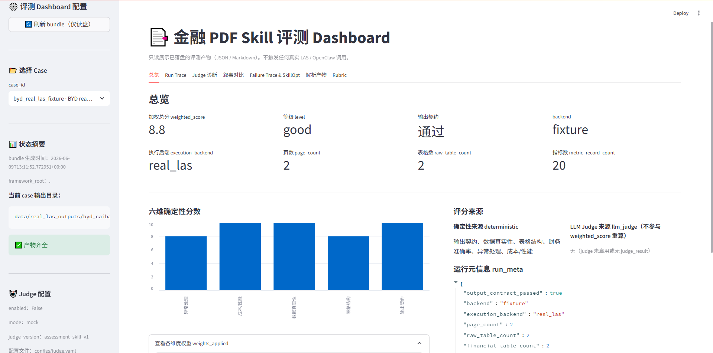
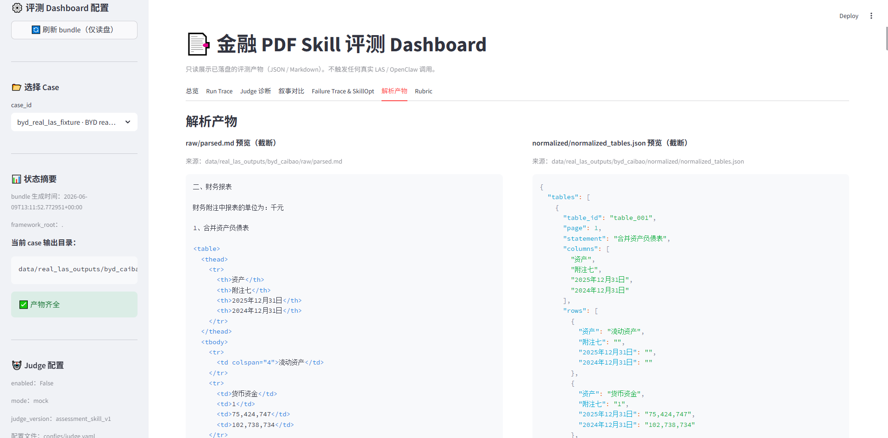
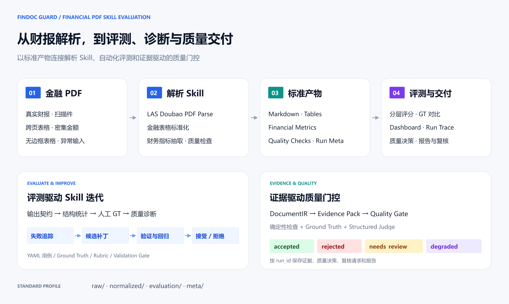

<div align="center">

# FinDoc Guard

**金融 PDF 解析 Skill · 自动化评测 · 证据驱动的质量门控**

解析财报，量化质量，追踪失败，验证每一次 Skill 改进。

[](https://www.python.org/)
[](financial-pdf-skill-eval-framework/tests/)
[](financial-pdf-skill-eval-framework/dashboard/)
[](skills/financial-pdf-parse-doubao-eval/SKILL.md)
[](LICENSE)

[产品预览](#产品预览) · [核心能力](#核心能力) · [工作流](#工作流) · [快速开始](#快速开始) · [文档导航](#文档导航)

</div>

FinDoc Guard 面向金融财报 PDF，提供从**解析、评测到质量决策**的完整工具链。开发者可以用金融解析 Skill 提取表格与财务指标，用 YAML 用例和人工 Ground Truth 检查输出质量，在 Dashboard 中查看评分、解析产物和运行轨迹，并通过验证与回归门控评估候选修改。

适用于财报数据抽取、解析 Skill 选型与回归测试，以及金融文档处理流程的质量检查。

## 产品预览

**在一个界面查看用例评分、财务指标与执行状态。**



仪表盘提供总览、Run Trace、Judge 诊断、Failure Trace、解析产物和 Rubric 等视图，支持从用例结果进一步查看评分依据与执行过程。

<details>
<summary><strong>查看解析产物：Markdown 与标准化表格并排预览</strong></summary>



按用例查看 `raw/parsed.md` 与 `normalized/normalized_tables.json`，核对表头、期间列和金额字段。

</details>

## 核心能力

| 能力 | 你可以做什么 |
| --- | --- |
| **金融解析 Skill** | 基于 LAS Doubao PDF Parse 解析财报，生成 Markdown、标准化表格、财务指标与质量检查结果。 |
| **四层自动化评测** | 从输出契约、结构统计、人工 GT 准确率到质量诊断，逐层检查解析结果。 |
| **可视化排查** | 在 Dashboard 中查看用例评分、原始产物、阶段耗时与失败记录，定位需要改进的环节。 |
| **Skill 迭代验证** | 从 failure trace 生成候选 patch，通过验证集与回归门控对比修改前后的表现。 |
| **证据与质量决策** | 将解析结果组织为 DocumentIR 与 Evidence Pack，结合规则、GT 和结构化 Judge 信号输出质量决策。 |
| **按运行追溯** | 通过 `run_id`、manifest、内容哈希与重试关联，追踪输入、配置、证据和报告。 |

## 工作流



<p align="center"><a href="docs/assets/findoc-workflow.drawio">编辑此图（draw.io）</a></p>

**解析与评测通过 standard profile 衔接。** 金融解析 Skill 负责生成文本、表格与财务字段；评测框架读取标准产物，执行用例校验、评分、诊断与报告生成。

```text
standard/
├── raw/parsed.md                        # 解析后的文档内容
├── normalized/normalized_tables.json   # 标准化表格
├── normalized/financial_summary.json   # 财务指标
├── evaluation/quality_checks.json      # 质量检查
└── meta/run_meta.json                  # 执行元信息
```

**FinDoc 质量门控进一步组织证据与交付结果。** 工作流生成统一文档表示 DocumentIR 和可引用的 Evidence Pack，按质量策略输出 `accepted`、`rejected`、`needs_review` 或 `degraded`，并保存质量决策、复核请求和 Markdown 报告。

## 如何评测

| 层级 | 检查内容 | 代表指标与产物 |
| --- | --- | --- |
| **输出契约** | 必需文件、JSON 格式与 Markdown 内容 | `output_contract_passed` |
| **结构统计** | 表格恢复、财务表识别与指标抽取 | `raw_table_count`、`financial_table_count`、`metric_record_count` |
| **GT 准确率** | 与人工标注的科目、期间和数值逐项对比 | `exact_match_accuracy`、`numeric_accuracy`、`failed_items` |
| **质量诊断** | 阅读顺序、表格结构、证据对齐与失败阶段 | Judge 诊断、failure trace、候选 patch |

综合评分覆盖输出契约、数据真实性、表格结构、财务准确率、异常处理和成本性能六个维度。通过 YAML 用例、评分配置与 Rubric，可以为不同文档场景组织评测。

用例设计涵盖清晰财报、扫描件、跨页表格、无边框表格、密集金额、多栏文本、无表格文档及异常 PDF。新增样本时，将 PDF、用例配置和人工 GT 配对，即可扩展回归集。

## 快速开始

### 运行质量门控示例

准备 **Python 3.10+**。内置示例使用标准库，生成 20 个合成回放用例，演示文档转换、证据构建与质量决策。

```bash
git clone https://github.com/zed123214/financial-pdf-skill-eval.git
cd financial-pdf-skill-eval/financial-pdf-skill-eval-framework

python -m tools.run_t6_baseline --output runs/demo-001 --verification-id demo-001
```

运行后查看 `runs/demo-001/baseline_summary.md`。用例索引位于 `baseline_manifest.json`，各用例的 `manifest.json` 记录对应的文档、证据、决策与报告路径。再次运行时，更换输出目录和 verification ID 即可保留多轮结果。

### 检查自己的解析结果

准备 PDF 文件及其 standard 解析产物目录，在框架目录执行：

```bash
python -m findoc guard --input sample.pdf --fixture-output-dir sample-standard --run-root runs --policy configs/findoc_quality_policy.json
```

在[质量策略](financial-pdf-skill-eval-framework/configs/findoc_quality_policy.json)中设置证据覆盖率、GT 分数与 Judge 相关阈值。用 `--parent-run-id` 关联上一轮运行，追踪修改与重试。

### 启动 Skill 评测仪表盘

在框架目录安装评测与界面依赖：

```bash
python -m pip install -r requirements.txt -r requirements-dashboard.txt
python run.py --build-dashboard-bundle
python run.py --serve-dashboard
```

打开 [localhost:8501](http://localhost:8501)。仪表盘读取本地评测产物；将已有 standard 用例目录放入 `outputs/` 后，可执行以下命令导入并刷新展示：

```bash
python run.py --import-real-outputs outputs
python run.py --build-dashboard-bundle
```

从 PDF 开始运行解析，请查看[金融解析 Skill 使用说明](skills/financial-pdf-parse-doubao-eval/SKILL.md)。

<details>
<summary><strong>使用 Docker 启动仪表盘</strong></summary>

在仓库根目录执行：

```bash
docker build -t findoc-guard .
docker run --rm -p 8501:8501 findoc-guard
```

容器启动后访问 [localhost:8501](http://localhost:8501)，查看镜像中打包的评测产物。

</details>

## 开发与测试

在 `financial-pdf-skill-eval-framework` 目录执行：

```bash
# Skill 评测框架的离线测试
python -m pytest -m offline -q

# FinDoc 文档、证据、门控与运行管理测试
python -m unittest tests.test_16_findoc_t1 tests.test_17_openclaw_t2 tests.test_18_evidence_judge_t3 tests.test_19_quality_gate_t4 tests.test_20_runtime_isolation_t5 tests.test_21_t6_baseline -q
```

欢迎贡献解析适配器、评测用例、人工 GT、评分规则和诊断视图。提交 [Issue](https://github.com/zed123214/financial-pdf-skill-eval/issues) 时，请附上复现命令、Python 版本和相关产物；提交修改时，请运行对应模块的测试。

## 文档导航

| 入口 | 内容 |
| --- | --- |
| [金融解析 Skill](skills/financial-pdf-parse-doubao-eval/SKILL.md) | 环境配置、解析调用与标准输出 |
| [框架运行指南](financial-pdf-skill-eval-framework/README_zh.md) | 合成回放、质量策略与评测入口 |
| [评测配置与用例](financial-pdf-skill-eval-framework/testcases/) | 按场景组织的 YAML 用例 |
| [质量策略](financial-pdf-skill-eval-framework/configs/findoc_quality_policy.json) | 证据、GT 与 Judge 阈值配置 |
| [Skill 优化模块](financial-pdf-skill-eval-framework/optimizer/) | 候选补丁与验证、回归门控 |
| [FinDoc 核心](financial-pdf-skill-eval-framework/findoc/) | 文档表示、证据、Judge、质量门控和运行管理 |

## License

[MIT](LICENSE)
