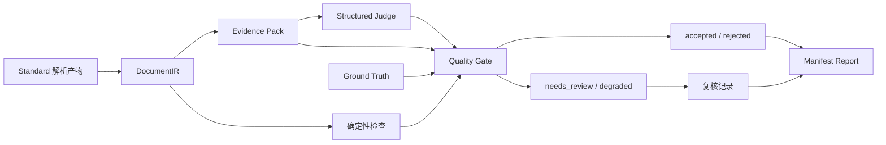

<div align="center">

# FinDoc Guard

**金融文档 Skill 评测与可追溯质量门控**

从结构化结果到质量决策，让每一轮文档处理都有据可查。

[](https://www.python.org/)
[](LICENSE)

[快速开始](#快速开始) · [工作流](#工作流) · [示例结果](#示例结果) · [开发与测试](#开发与测试)

</div>

FinDoc Guard 为金融 PDF 解析结果提供统一的质量检查流程：将文本、表格和财务字段组织为 **DocumentIR**，生成可引用的 **Evidence Pack**，结合确定性检查、Ground Truth 与结构化 Judge 信号，输出接受、拒绝、人工复核或降级决策。

项目同时包含金融解析 Skill、分层评测、失败追踪与候选补丁回归门控，支持从单份文档检查到批量用例验证的开发流程。

## 核心功能

- **统一文档表示**：通过 DocumentIR 管理文本、表格、财务字段及来源信息，以固定 schema 连接处理阶段。
- **证据可追溯**：为证据分配内容标识，绑定输入、配置和运行信息；校验 Judge 的证据引用。
- **四路质量决策**：按版本化策略输出 `accepted`、`rejected`、`needs_review` 或 `degraded`，记录原因与严重度。
- **按运行隔离产物**：使用独立 `run_id`、阶段 attempts 和重试 lineage 管理执行过程；通过 manifest 与 SHA-256 校验读取本轮产物。
- **复核与报告**：生成 Markdown 报告和结构化复核请求，将结论、证据及处理状态放在同一条记录中。
- **Skill 迭代工具链**：用分层评分与 failure trace 定位问题，通过候选 patch 和 validation / regression gate 检查改动。

## 快速开始

FinDoc 核心流程使用 Python 标准库。以下命令运行内置的 **20-case 合成回放示例**，自动生成输入、配套解析结果与质量报告。

```bash
git clone https://github.com/zed123214/financial-pdf-skill-eval.git
cd financial-pdf-skill-eval/financial-pdf-skill-eval-framework

python -m tools.run_t6_baseline --output runs/demo-001 --verification-id demo-001
```

运行后打开：

```text
runs/demo-001/
├── baseline_summary.md       # 汇总结果
├── baseline_manifest.json    # 用例、指标与产物索引
└── runs/
    ├── t6_case_001/           # 接受路径
    ├── t6_case_016/           # 人工复核路径
    └── t6_case_020/           # 缺少质量产物的失败路径
```

再次运行时，为 `--output` 与 `--verification-id` 指定新的名称，即可保留多轮结果进行对照。

### 检查自己的解析结果

准备 PDF 与对应的 `standard` 格式解析产物目录，然后执行：

```bash
python -m findoc guard --input sample.pdf --fixture-output-dir sample-standard --run-root runs --policy configs/findoc_quality_policy.json
```

其中 `sample.pdf` 用于输入身份与哈希绑定，`sample-standard` 提供本轮回放的解析结果。使用 `--parent-run-id` 可以关联前一轮运行。

也可以单独生成 DocumentIR：

```bash
python -m findoc analyze --input sample.pdf --fixture-output-dir sample-standard --run-root runs
python -m findoc --help
```

解析产物目录规范与其他评测入口见[框架说明](financial-pdf-skill-eval-framework/README_zh.md)。

## 工作流



质量门控先处理关键规则与 GT 检查，再结合证据覆盖和 Judge 信号做出决策。你可以在[质量策略](financial-pdf-skill-eval-framework/configs/findoc_quality_policy.json)中配置证据覆盖率、GT 分数和 Judge 相关阈值。

每轮运行保存以下产物：

| 产物 | 内容 |
| --- | --- |
| `manifest.json` | 运行状态、阶段尝试、配置哈希及当前产物登记 |
| `document_ir.json` | 文档结构、财务字段与来源信息 |
| `evidence_pack.json` | 证据条目、内容标识与覆盖情况 |
| `judge_result.json` | 结构化判断、证据引用及 Judge 状态 |
| `quality_decision.json` | 质量决策、原因和严重度 |
| `human_review_request.json` | 进入复核流程时的待处理记录 |
| `report.md` | 本轮运行的 Markdown 报告 |

## 示例结果

2026-10-24，使用 Windows / Python 3.13.5 运行上述合成回放示例：

| 检查项 | 结果 |
| --- | --- |
| 合成用例 | 20 个 |
| 工作流完成 | 19/20；1 个缺少质量产物的失败注入用例 |
| DocumentIR schema 校验 | 19/19 |
| 证据覆盖 | 53/57 |
| 决策分布 | 15 接受、4 人工复核、1 在门控前失败 |
| Judge 模式 | 离线 abstain |
| 过期产物检查 | 2 次拒绝过期或篡改产物、1 次忽略未登记文件 |

你可以在 `baseline_manifest.json` 中查看每个用例的输入哈希、证据、执行状态和分组指标。

## 开发与测试

在 `financial-pdf-skill-eval-framework` 目录运行 FinDoc 功能与发布扫描测试：

```bash
python -m unittest tests.test_16_findoc_t1 tests.test_17_openclaw_t2 tests.test_18_evidence_judge_t3 tests.test_19_quality_gate_t4 tests.test_20_runtime_isolation_t5 tests.test_21_t6_baseline static_tests.test_security_release_surface -q
```

本次验证 **43 项通过**，覆盖文档适配、OpenClaw 返回契约、证据与 Judge、质量门控、运行隔离、合成基线和脱敏规则。

| 模块 | 源码入口 |
| --- | --- |
| CLI 与流程编排 | [findoc/cli.py](financial-pdf-skill-eval-framework/findoc/cli.py) · [guarded_workflow.py](financial-pdf-skill-eval-framework/findoc/guarded_workflow.py) |
| 文档与证据 | [models](financial-pdf-skill-eval-framework/findoc/models/) · [evidence](financial-pdf-skill-eval-framework/findoc/evidence/) |
| Judge 与质量门控 | [judge](financial-pdf-skill-eval-framework/findoc/judge/) · [quality](financial-pdf-skill-eval-framework/findoc/quality/) |
| 状态与产物管理 | [runtime](financial-pdf-skill-eval-framework/findoc/runtime/) · [reporting](financial-pdf-skill-eval-framework/findoc/reporting/) |
| Skill 评测与候选补丁 | [framework](financial-pdf-skill-eval-framework/framework/) · [optimizer](financial-pdf-skill-eval-framework/optimizer/) |
| 金融解析 Skill | [skills](skills/) |

欢迎通过 [Issues](https://github.com/zed123214/financial-pdf-skill-eval/issues) 提交问题与用例，或通过 Pull Request 改进适配器、质量策略和测试。提交问题时请附上复现命令、Python 版本及相关错误信息。

## License

[MIT](LICENSE)
