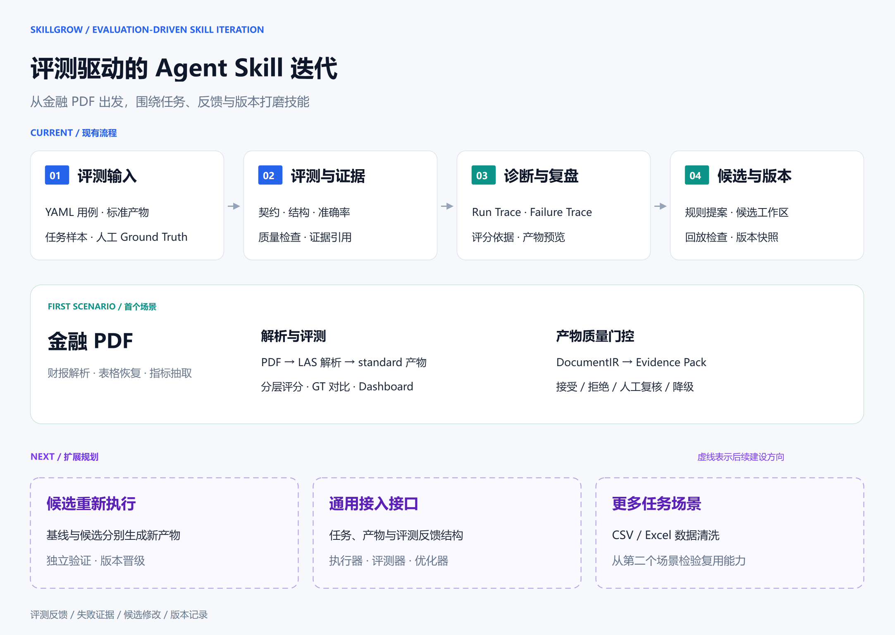

<div align="center">

# SkillGrow

**评测驱动的 Agent Skill 迭代工作台**

从任务结果出发，找到失败原因，打磨下一版 Skill。

[](https://www.python.org/)
[](financial-pdf-skill-eval-framework/tests/)
[](financial-pdf-skill-eval-framework/dashboard/)
[](#首个场景金融-pdf)
[](LICENSE)

[产品预览](#产品预览) · [工作流](#工作流) · [首个场景](#首个场景金融-pdf) · [快速开始](#快速开始) · [扩展路线](#扩展路线)

</div>

SkillGrow 帮助开发者围绕**任务用例、评测反馈与候选版本**组织 Skill 迭代：检查输出质量，追踪失败原因，整理修改提案，在工作台中查看产物、证据与回归记录。

**金融 PDF 是首个落地场景。** 项目提供金融解析 Skill、分层评测、诊断视图、候选补丁工作区与文档质量门控。扩展路线围绕执行器、评测器与优化器展开，逐步将这套工作方式带到更多任务中。

## 产品预览

**从用例总览到失败现场，查看 Skill 的表现与改进线索。**


上图展示金融 PDF 场景。仪表盘提供总览、Run Trace、Judge 诊断、Failure Trace、解析产物和 Rubric 等视图，可按用例查看评分依据、阶段耗时与输出内容。

<details>
<summary><strong>查看解析产物：Markdown 与标准化表格并排预览</strong></summary>


按用例查看 `raw/parsed.md` 与 `normalized/normalized_tables.json`，核对表头、期间列和金额字段。

</details>

## 核心能力

| 能力 | 在金融 PDF 场景中的应用 |
| --- | --- |
| **用例与分层评测** | 用 YAML 组织任务，从输出契约、结构统计、人工 GT 准确率到质量诊断，逐层检查结果。 |
| **可视化复盘** | 在 Dashboard 中查看评分、解析产物与执行轨迹，定位表格恢复、字段抽取和证据对齐问题。 |
| **候选修改管理** | 根据 failure trace 生成规则模板补丁，在独立工作区管理候选，记录产物回放评分、回归检查与版本快照。 |
| **证据与质量决策** | 将解析结果组织为 DocumentIR 与 Evidence Pack，结合规则、GT 和结构化 Judge 信号输出质量决策。 |
| **按运行追溯** | 在文档质量工作流中，通过 `run_id`、manifest、内容哈希与重试关联，追踪输入、配置、证据和报告。 |

## 工作流



<p align="center"><a href="docs/assets/skillgrow-workflow.drawio">编辑此图（draw.io）</a></p>

工作台围绕四个环节组织信息：**准备评测输入 → 检查质量 → 诊断失败 → 管理候选修改**。金融 PDF 场景通过标准产物连接这些环节；图中虚线区域标注后续扩展方向。

## 首个场景：金融 PDF

金融财报包含多级表头、期间列、密集金额和跨页表格，适合检验 Skill 的结构恢复与字段抽取能力。项目中的 `financial-pdf-parse-doubao-eval` 基于 LAS Doubao PDF Parse，生成 Markdown、标准化表格、财务指标和质量检查结果。

**解析与评测通过 standard profile 衔接。** 金融解析 Skill 负责生成文本、表格与财务字段；评测框架读取标准产物，执行用例校验、评分、诊断与报告生成。

```text
standard/
├── raw/parsed.md                        # 解析后的文档内容
├── normalized/normalized_tables.json   # 标准化表格
├── normalized/financial_summary.json   # 财务指标
├── evaluation/quality_checks.json      # 质量检查
└── meta/run_meta.json                  # 执行元信息
```

**文档质量门控负责解析产物的交付判断。** 场景内的 FinDoc 模块生成统一文档表示 DocumentIR 和可引用的 Evidence Pack，按质量策略输出 `accepted`、`rejected`、`needs_review` 或 `degraded`，并保存质量决策、复核请求和 Markdown 报告。

### 四层评测

| 层级 | 检查内容 | 代表指标与产物 |
| --- | --- | --- |
| **输出契约** | 必需文件、JSON 格式与 Markdown 内容 | `output_contract_passed` |
| **结构统计** | 表格恢复、财务表识别与指标抽取 | `raw_table_count`、`financial_table_count`、`metric_record_count` |
| **GT 准确率** | 与人工标注的科目、期间和数值逐项对比 | `exact_match_accuracy`、`numeric_accuracy`、`failed_items` |
| **质量诊断** | 阅读顺序、表格结构、证据对齐与失败阶段 | Judge 诊断、failure trace、候选 patch |

综合评分覆盖输出契约、数据真实性、表格结构、财务准确率、异常处理和成本性能六个维度。通过 YAML 用例、评分配置与 Rubric，可以调整评测重点。

用例设计涵盖清晰财报、扫描件、跨页表格、无边框表格、密集金额、多栏文本、无表格文档及异常 PDF。新增样本时，将 PDF、用例配置和人工 GT 配对，即可扩展回归集。

## 快速开始

### 运行金融 PDF 场景示例

准备 **Python 3.10+**。内置示例使用标准库，生成 20 个合成回放用例，演示文档转换、证据构建与质量决策。

```bash
git clone https://github.com/zed123214/SkillGrow.git
cd SkillGrow/financial-pdf-skill-eval-framework

python -m tools.run_t6_baseline --output runs/demo-001 --verification-id demo-001
```

运行后查看 `runs/demo-001/baseline_summary.md`。用例索引位于 `baseline_manifest.json`，各用例的 `manifest.json` 记录对应的文档、证据、决策与报告路径。再次运行时，更换输出目录和 verification ID 即可保留多轮结果。

### 检查自己的解析结果

准备 PDF 文件及其 standard 解析产物目录，在框架目录执行：

```bash
python -m findoc guard --input sample.pdf --fixture-output-dir sample-standard --run-root runs --policy configs/findoc_quality_policy.json
```

在[质量策略](financial-pdf-skill-eval-framework/configs/findoc_quality_policy.json)中设置证据覆盖率、GT 分数与 Judge 相关阈值。用 `--parent-run-id` 关联上一轮运行，追踪修改与重试。

### 启动 Skill 评测仪表盘

在框架目录安装评测与界面依赖：

```bash
python -m pip install -r requirements.txt -r requirements-dashboard.txt
python run.py --build-dashboard-bundle
python run.py --serve-dashboard
```

打开 [localhost:8501](http://localhost:8501)。仪表盘读取本地评测产物；将已有 standard 用例目录放入 `outputs/` 后，可执行以下命令导入并刷新展示：

```bash
python run.py --import-real-outputs outputs
python run.py --build-dashboard-bundle
```

从 PDF 开始运行解析，请查看[金融解析 Skill 使用说明](skills/financial-pdf-parse-doubao-eval/SKILL.md)。

<details>
<summary><strong>使用 Docker 启动仪表盘</strong></summary>

在仓库根目录执行：

```bash
docker build -t skillgrow .
docker run --rm -p 8501:8501 skillgrow
```

容器启动后访问 [localhost:8501](http://localhost:8501)，查看镜像中打包的评测产物。

</details>

## 扩展路线

SkillGrow 的下一步是把金融 PDF 场景中积累的评测与迭代流程，整理为可接入更多任务的接口。设计方向是：**场景定义任务和评分依据，执行器产生结果，优化器提出修改，工作台记录证据与版本变化。**

以下为后续规划：

- [ ] **候选执行闭环**：用基线与候选 Skill 分别重新生成产物，在独立验证集上比较效果，再保存通过门控的版本。
- [ ] **场景接入接口**：统一任务、产物引用与评测反馈的结构，将金融字段、DocumentIR 和领域评分保留在文档场景模块中。
- [ ] **第二个场景**：接入 CSV／Excel 数据清洗，用字段规范、数值校验与处理结果检验跨任务复用。
- [ ] **优化与执行扩展**：探索 GEPA／SkillOpt 候选生成，以及不同 Agent 执行环境的接入，记录每轮改进的质量、耗时与成本变化。

## 开发与测试

在 `financial-pdf-skill-eval-framework` 目录执行：

```bash
# Skill 评测框架的离线测试
python -m pytest -m offline -q

# FinDoc 文档、证据、门控与运行管理测试
python -m unittest tests.test_16_findoc_t1 tests.test_17_openclaw_t2 tests.test_18_evidence_judge_t3 tests.test_19_quality_gate_t4 tests.test_20_runtime_isolation_t5 tests.test_21_t6_baseline -q
```

欢迎贡献金融 PDF 用例、人工 GT、评分规则和诊断视图，也欢迎在 [Issues](https://github.com/zed123214/SkillGrow/issues) 讨论新的任务场景与接入设计。报告问题时请附上复现命令、Python 版本和相关产物；提交修改时请运行对应模块的测试。

## 文档导航

| 入口 | 内容 |
| --- | --- |
| [金融解析 Skill](skills/financial-pdf-parse-doubao-eval/SKILL.md) | 环境配置、解析调用与标准输出 |
| [框架运行指南](financial-pdf-skill-eval-framework/README_zh.md) | 合成回放、质量策略与评测入口 |
| [评测配置与用例](financial-pdf-skill-eval-framework/testcases/) | 按场景组织的 YAML 用例 |
| [质量策略](financial-pdf-skill-eval-framework/configs/findoc_quality_policy.json) | 证据、GT 与 Judge 阈值配置 |
| [候选与回归模块](financial-pdf-skill-eval-framework/optimizer/) | 规则补丁提案、候选工作区与回归检查 |
| [文档质量模块](financial-pdf-skill-eval-framework/findoc/) | DocumentIR、证据、Judge、质量门控和运行管理 |

## License

[MIT](LICENSE)
